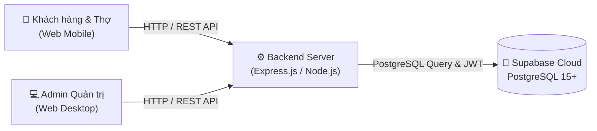

# 🏠 HomeFix - Nền Tảng Gọi Thợ Sửa Chữa Tại Nhà Theo Yêu Cầu

> **Đề án Khởi nghiệp đổi mới sáng tạo (EXE101) - Đại học FPT**  
> **Slogan:** *"An tâm về thợ - Minh bạch về giá - Tiện lợi mọi lúc"*

---

## 🌐 SẢN PHẨM NÀY CHẠY TRÊN ĐÂU? (KIẾN TRÚC VẬN HÀNH)

Hệ thống **HomeFix** được thiết kế theo kiến trúc **Cloud-Native 3 tầng**:



1. **Khách hàng & Thợ:** Truy cập qua trình duyệt Web trên điện thoại thông minh (Responsive Web App).
2. **Backend Server:** Chạy bằng **Node.js (Express framework)**. Khi code dưới máy thì chạy tại `http://localhost:5000`. Khi báo cáo đồ án thì deploy lên cloud hosting miễn phí (**Render.com** hoặc **Railway.app**).
3. **Cơ sở dữ liệu (Database):** Toàn bộ dữ liệu nằm trên **PostgreSQL 15+** được host trực tuyến 24/7 trên **Supabase Cloud (Singapore)**. Nhờ đó mọi thành viên trong nhóm code ở bất cứ đâu đều dùng chung một Database thực tế.

---

## 📌 TÀI LIỆU QUAN TRỌNG CHO CẢ NHÓM

* 📋 **[TASKS.md](./TASKS.md):** Kế hoạch và bảng phân chia nhiệm vụ Giai đoạn 2 (Hoàn thiện đồ án).
* 🛡️ **[TEAM_RULES.md](./TEAM_RULES.md):** Quy tắc làm việc nhóm, Git Workflow chống conflict, chuẩn API Contract và Checklist nhiệm vụ từng người.
* ⚙️ **[Backend README](./backend/README.md):** Hướng dẫn chi tiết cài đặt, cấu trúc code, cách chạy PostgreSQL (Cloud hoặc Local) và danh sách API.
* 📮 **[Postman Collection](./backend/HomeFix_Backend1_Postman_Collection.json):** Bộ test API tự động hoàn chỉnh để Frontend tải về test ngay.
* 🗄️ **[Database Migration SQL](./backend/src/database/migration.sql):** Mã nguồn tạo 3 bảng `users`, `services`, `bookings` bằng PostgreSQL thuần.

---

## 👥 PHÂN CÔNG NHIỆM VỤ DỰ ÁN

| Thành viên | Nhiệm vụ | Trọng tâm bàn giao |
|---|---|---|
| **Frontend 1** | Giao diện Trang chủ & Dịch vụ | Layout chung, Trang chủ, Danh sách & Chi tiết dịch vụ, Responsive. |
| **Frontend 2** | Đặt lịch & Quản lý đơn hàng | Form đặt lịch, Trang lịch sử đặt lịch, Theo dõi trạng thái đơn hàng. |
| **Frontend 3** | Tài khoản & Dashboard Admin | Đăng nhập/Đăng ký, Trang cá nhân, Dashboard Admin quản lý dịch vụ và đơn. |
| **Backend 1** | Authentication & Database | Cấu trúc Express, PostgreSQL DB (3 bảng), API Auth & Profile, JWT, RBAC. *(Đã hoàn thành 100% ✅)* |
| **Backend 2** | Services, Booking & Deployment | API Dịch vụ, API Đặt lịch, API Admin quản trị đơn, Deploy backend thử nghiệm. |

---

## 🚀 HƯỚNG DẪN CHẠY NHANH BACKEND

```bash
# 1. Di chuyển vào thư mục backend
cd backend

# 2. Cài đặt thư viện
npm install

# 3. Tạo file .env và điền Supabase Key
cp .env.example .env

# 4. Chạy kiểm thử tự động 7/7 kịch bản
npm test

# 5. Khởi động server
npm run dev
```

Server chạy tại: `http://localhost:5000`
